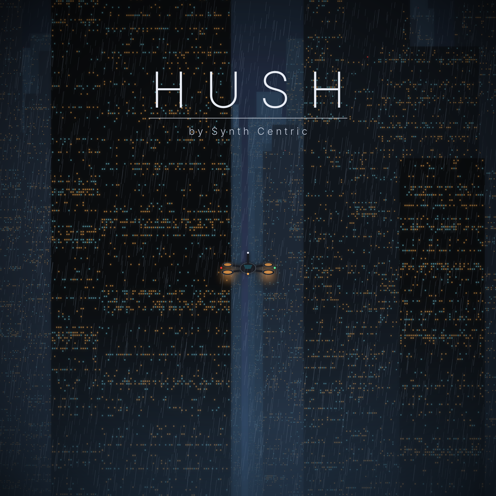
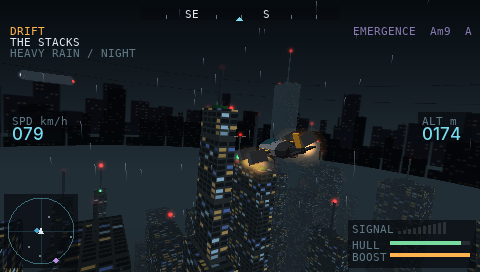
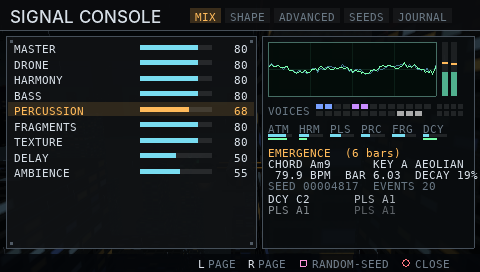

# HUSH
### A Generative Cyberpunk Flight Experience — by Synth Centric



HUSH is an original homebrew game for the Sony PlayStation Portable. You fly the **Moth**, a small
vertical-thrust observation craft of the Municipal Signal Authority, through **Vesper**, a privately
administered megacity in 2146. Rain, fog, towers, traffic and your own flight continuously steer a
**real-time generative synthesizer** running on the PSP. There are no recorded songs: every note is
composed and synthesised as you fly.

> The game is an instrument. The city is the interface. Flying is a form of composition.

| Mode | What it is |
|---|---|
| **PATROL** | Twelve missions across four districts: surveillance, pursuit, investigation and an unlicensed signal that has no source. |
| **DRIFT** | Unrestricted flight in any district, any weather. The city keeps living; the music never stops. |
| **SIGNAL CONSOLE** | The synthesizer itself: mix, shape, seeds, presets, a live oscilloscope and voice monitor. |

 

## Features (implemented)
- Four navigable 3D districts generated from fixed seeds — **Civic Centre**, **The Works**, **The Stacks**, **The Undertow** — with
  lit-window facades, aviation lights, adverts, elevated highways, cooling towers, chimneys, walkways, flooded streets.
- Arcade hover physics with inertia, hover stabilisation, boost, brake, collision, banking; chase, cockpit and cinematic cameras.
- **Street level**: descend between the towers to rain-slick streets lined with lit shopfronts, hanging neon blade signs,
  holographic billboards, dashed lanes, street traffic and **pedestrians** with glowing umbrellas who scatter from your downwash.
- Neon everywhere: roof outlines, corner strips, billboards in every district, wet-street reflections, violet/red/magenta haze.
- Living city: lane-following aerial and ground traffic, patrol craft, steam vents, rain, fog, twilight.
- **Story**: a prologue, 12 missions with briefings and radio, an Operator's Log after each mission, a Case File to reread
  them, and overheard street chatter that changes as the investigation unfolds.
- Generative music engine: six interacting layers (atmosphere, harmony, pulse, percussion, fragments, decay), band-limited
  wavetable synthesis, FM, SVF filters, dub delay, FDN ambience, chorus, radio degradation; long-form sections; motif memory;
  deterministic seeds. The world drives it: altitude, speed, district, rain, fog, pursuit, traffic, enclosure, scanning.
- Five **sonic landmarks** that genuinely transform the music: the Choir Tower, Station Nine, the Memory Archive,
  the Black Reservoir and the Silent Exchange.
- 12 missions with real objectives (goto, scan, locate by signal strength, follow, pursue + EMP, collect, timed rings,
  landmark investigation, docking, listening), failure/retry, rewards and progression.
- Saves with CRC validation and backup; options; full menus; credits.
- **hush-render**: a desktop renderer that uses the same engine code to render WAV files.

## Quick start
**Real PSP (custom firmware):** copy `release/HUSH_by_Synth_Centric/PSP/GAME/HUSH/` to `ms0:/PSP/GAME/HUSH/` and launch from *Game › Memory Stick*.
**PPSSPP:** *Load…* → `EBOOT.PBP`.

Controls (default face-button scheme — full list in [docs/CONTROLS.md](docs/CONTROLS.md)): nub = fly/strafe, L/R = turn,
△ ascend, ✕ descend, □ boost, ○ scan (hold) / EMP (press), D-pad ↓ brake, D-pad ↑ HUD, SELECT camera, START pause.
A *Classic* scheme (altitude on the D-pad) is in Options.

## Building
See [docs/BUILD.md](docs/BUILD.md). In short, with PSPDEV installed at `/usr/local/pspdev`:
```bash
make
```
```bash
make test
```
```bash
./build/host/hush-render --seed 4817 --preset drift --minutes 10 --output hush_drift.wav
```

## Compatibility
Built for firmware 5.00+ user mode, PSP-1000 baseline (no extra-RAM features required). Validated in PPSSPP
(headless, software renderer). **Not yet tested on physical hardware** — see [docs/TESTING.md](docs/TESTING.md).

## Documentation
[Player manual](docs/HUSH_Manual.md) · [Build](docs/BUILD.md) · [Controls](docs/CONTROLS.md) · [Audio engine](docs/AUDIO_ENGINE.md) ·
[Design](docs/DESIGN.md) · [Testing](docs/TESTING.md) · [Licence](LICENSE)

## Audio previews
`audio/preview/` holds MP3 previews of five reference renders (full-quality WAVs are produced by `make release`):
Civic Centre, The Works, The Stacks, The Undertow, and a 20-minute Drift. Seeds and settings are in
[docs/AUDIO_ENGINE.md](docs/AUDIO_ENGINE.md#reference-renders).

## Credits
HUSH is by **Synth Centric**. Programming was carried out with Claude Code (Anthropic). Typefaces: DejaVu Sans Mono,
Inter. Built with the PSPDEV toolchain. All artwork is generated by code in this repository; all music by the engine.
