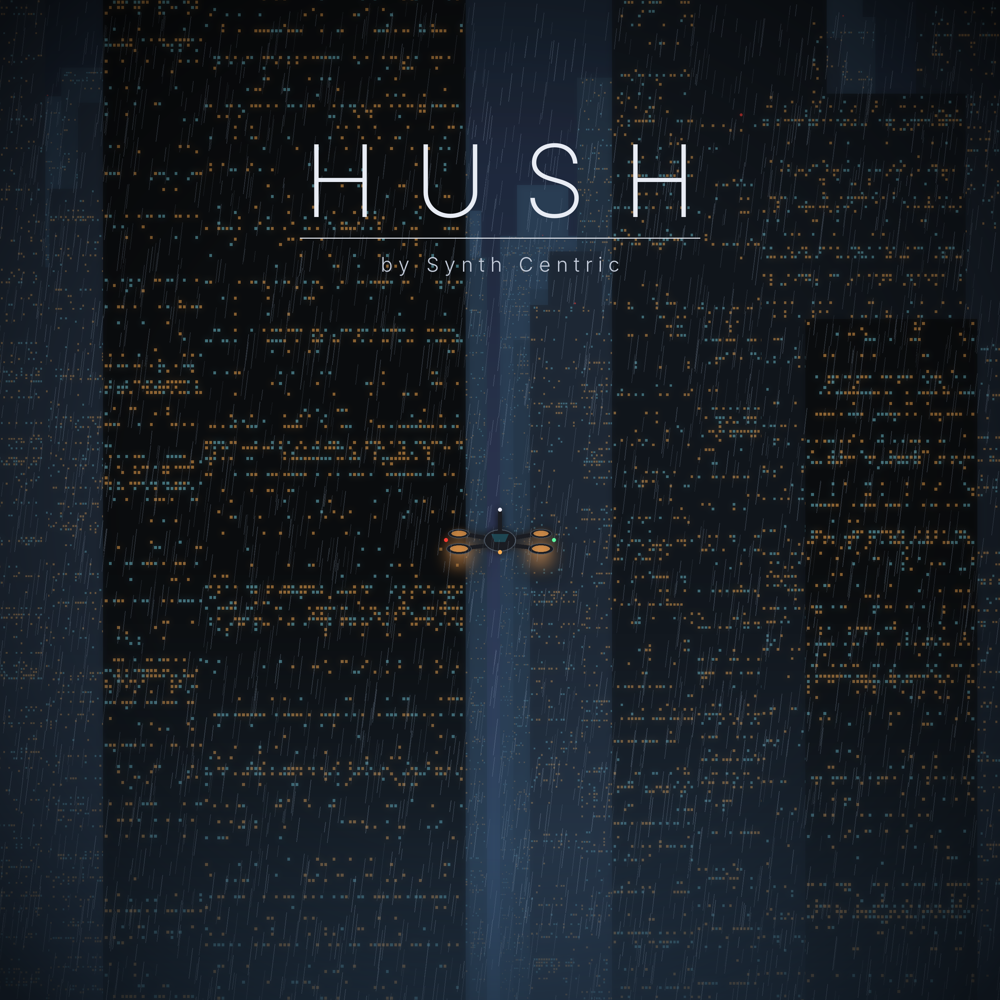

# 1. Introduction

The rain has not stopped in Vesper for eleven days. Somewhere under it, on a frequency nobody owns, someone is playing music.

**HUSH** is a game you fly and an instrument you play at the same time. You are an operator of the Municipal Signal Authority,
piloting a small observation craft through a city of towers, smog and flooded streets. Everything in the city — your height,
your speed, the district, the weather, the traffic, the places you approach — is quietly composing the music you hear.
Nothing is pre-recorded. Every note is decided and synthesised on your PSP while you fly.

You can follow the investigation in **PATROL**, wander without purpose in **DRIFT**, or put the craft away and play the
synthesizer itself in the **SIGNAL CONSOLE**. All three are open from the moment you start.

# 2. Welcome to Vesper

Vesper is a privately administered coastal megacity. In 2146 it has more registered citizens than people anyone can find,
more licences than freedoms, and more light than daylight. You will work in four districts:

- **Civic Centre** — corporate towers in cold glass, enormous advertising, elevated highways, surveillance spires. Here the
  music is controlled: slow cold chords, restrained bass, geometric rhythms.
- **The Works** — substations, cooling towers, chimneys and pipe canyons glowing red through the smog. Distorted bass,
  metallic percussion, mechanical pulses.
- **The Stacks** — residential megablocks so close their walkways touch, rooftop gardens, illegal transmitters. Melancholy
  chords, warm pulses, broken rhythms, distant radio.
- **The Undertow** — the flooded lower city. Fog, ruins, water, almost no light. Very low drones and long silences.

Rainfall audio is the property of the WeatherHold Consortium. Silence is sold by the hour. Please do not hum in public
without registering the melody.

# 3. The Municipal Signal Authority

The MSA monitors broadcasts, inspects infrastructure and enforces the transmission code. Its operators fly alone, at night,
on routes nobody else wants. Your call sign is **Moth-7**. Dispatch will talk to you over the radio; so will Supervisor
Hale. Other voices may join them. Transmissions appear at the bottom of the screen with the speaker's name.

# 4. Operating the Moth

The **Moth** is a compact vertical-thrust craft: a short fuselage, a canopy, four ducted fans on outrigger arms, a sensor
head under the nose and skids for landing. It does not stall. **Release every control and it hovers where it is.**

- The four nacelles tilt into your movement and glow with thrust.
- Red (port) and green (starboard) running lights, a white tail strobe and an amber scanner light mark your position.
- **Hull**: collisions above walking pace and live steam vents damage it. In Patrol, a destroyed hull fails the mission;
  in Drift it slowly self-repairs.
- **Boost**: hold □ while flying forward. The gauge drains and recharges.
- **Scanner**: hold ○ facing a target with a clear line of sight. A sweeping beam shows it is active.
- **EMP**: fitted from the mission *The Archived Woman*. Press ○ within about 35 m of a hostile drone.

Engine hum is tuned to the current key of the music. Your craft is part of the composition.

# 5. Flight controls

| Input | Action (default *face buttons* scheme) |
|---|---|
| Analogue nub | Forward/back and strafe |
| L / R | Turn |
| △ (hold) | Climb |
| ✕ (hold) | Descend — right down to the street |
| □ (hold) | Boost |
| ○ | Hold to scan; press for the EMP / context action |
| D-pad ↓ (hold) | Brake |
| D-pad ↑ | Cycle the HUD |
| D-pad ← / → | Tilt the camera |
| SELECT | Chase → cockpit → cinematic camera |
| START | Pause menu |

Prefer altitude on the D-pad? Choose *Options › Control scheme › Classic* (D-pad ↑/↓ climb and descend, ✕ boost,
□ brake, △ scan, ○ action). Mission instructions always name the buttons of your chosen scheme.

**Cameras.** *Chase* follows behind and pulls in to avoid walls. *Cockpit* puts you behind the canopy with a full
instrument panel: attitude indicator, speed, altitude, hull and boost, radar, signal meter and a live oscilloscope of the
music. *Cinematic* drifts slowly around the craft with a letterbox — made for Drift.

**HUD.** Compass with objective bearing (top), speed (left), altitude (right), radar with traffic, landmarks and objective
(bottom left), signal strength, hull and boost (bottom right). The current musical section, chord and key appear top right.
Options offer FULL, MINIMAL and OFF.

**Tips.** Hover is precise: tap the nub to edge forward. Brake before corners in the Stacks. Climb above the skyline to
travel, then descend between the towers.

**Street level.** Hold ✕ and keep descending: the Moth will settle a few metres above the road. Down there the city is
loud with light — shopfronts, hanging neon signs, street traffic, and people under glowing umbrellas going about their
night. They will run if you come in too low. Hover slowly near them and you may overhear what Vesper is talking about.

# 6. Patrol Mode

Twelve assignments across the four districts. Each begins with a briefing; objectives appear top left, a cyan diamond
marks the target (with distance), and an arrow points the way when it is off screen. Assignments include:

- **Patrol routes** and **landing** on MSA platforms (descend slowly onto the pad).
- **Scanning** infrastructure and buildings (hold △ facing the target).
- **Locating** hidden transmitters: there is no marker until you are close — turn until the signal meter climbs.
- **Following** a vehicle at a distance: too close and it is alerted, too far and you lose it.
- **Pursuits**: chase a drone through the streets and disable it with the EMP.
- **Hazard runs**: checkpoint rings against a timer, past steam vents that fire on a cycle (wait for the warning lamps).
- **Recovering** data fragments by flying through them.
- **Investigating** sonic landmarks.

When you choose PATROL for the first time, a short **prologue** sets the scene (✕ to advance, START to skip).

If you fail, choose **Retry** or **Abandon**. Completing an assignment saves your progress and may unlock a district, an
upgrade (scanner range, boost, hull), a synthesizer waveform, a preset or a paint scheme.

**Operator's Log and Case File.** After each debrief, Operator Seven writes a short log entry. In the assignment list,
press △ to open the **Case File**: replay the prologue and reread every log entry and debrief. What people on the street
say also changes as the investigation goes on.

# 7. Drift Mode

No objectives, no timers. Choose a district (all four are open), weather (clear, light rain, heavy rain, fog or
*evolving*), time of day (night, twilight or a slow cycle), a music preset and a seed, then fly. Traffic keeps moving,
the weather changes, and the music never stops. The pause menu lets you change district, weather and time, open the Signal
Console, switch camera and hide the HUD.

Hold the scanner button (○, or △ in the Classic scheme) near a sonic landmark to identify it; it is then written into the **Journal**.

## Signal hunting

Thirty-two unlicensed transmissions — eight in each district — are hidden in the city: down in the streets, on rooftops,
high between the towers and out over the water. Nothing marks them on the map. When one is near, a faint shimmer hangs in
the air and the HUD reports **STATIC ON THE BAND**. Hold the scanner and listen: the ping ticks faster the closer you are
and the better you are facing it, the **SIGNAL TRACE** meter fills, and a chevron at the screen edge leans toward the source
when it is off your nose. Fly into it (within about 14 m) and keep holding the scanner until the lock completes.

A captured transmission plays once over the radio and is kept in the **Case File › Intercepts** (D-pad ←/→ to page).
Its short melodic motif also joins the music: from then on the composer occasionally quotes the motifs you have collected,
so every save slowly develops a sound of its own. The Drift HUD shows how many you have found in the current district.

## The city notices you

The streets react to the Moth. Pedestrians stop and look up when you hover across the street (some film you, phones
flashing), and scatter from your downwash when you come down among them; you will hear the crowd murmur and overhear what
they say about you. Cars stop and sound their horns when you hover in their lane; flying traffic climbs or dives around
you; patrol craft passing close mention you on the police band. Billboards near the Moth switch to the Authority's
messages. Hovering low throws up spray from the street or water, and holding the scanner too long near the ground
overloads a junction: the lights around you brown out for a few seconds. None of this adds load to the music engine.

# 8. Signal Console

The onboard synthesizer, styled as municipal equipment. Open it from the main menu (no flying) or from the pause menu
(the city keeps living behind it). Changes are heard immediately and smoothly — the composition evolves, it never restarts.

**Pages** (L/R): **MIX** — master and the six layer volumes, delay, ambience. **SHAPE** — density, darkness, motion, tempo,
key, mode (or *district*), filter, and (in the standalone console) the district *profile* that colours the sound.
**ADVANCED** — pad waveform (with a live waveform preview), detune, drone root, cutoff, LFO rate, harmonic complexity,
rhythm probability, sequence variation, melody probability, delay feedback, modulation depth. **SEEDS & PRESETS** — the
seed (✕ to edit digit by digit), randomise, eight seed slots (✕ recall, △ store), built-in presets and four user presets
(✕ load, △ save). **JOURNAL** — the sonic landmarks you have found.

**Displays** (right): a stereo oscilloscope and level meters of the actual output; voice activity for all 25 synth voices
(coloured by layer) and 8 percussion voices; the gain and level of the six layers; the current section and bars remaining,
chord, key and mode, tempo, bar and step, decay amount, seed and event count; and the last few notes played.

# 9. Generative composition

The music is made of six interacting systems:

1. **Atmosphere** — long drones and slow shimmering partials.
2. **Harmony** — evolving chords built from the current mode, with smooth voice leading, and dub-style chord stabs.
3. **Pulse** — a mutating bass sequencer and arpeggios.
4. **Percussion** — synthesised kicks, snares, metallic hats, clangs and clicks, from strict grids to broken rhythms.
5. **Fragments** — short melodic motifs that are remembered, recalled and varied; landmarks have motifs of their own.
6. **Decay** — erosion: pitch drift, dropouts, radio degradation, tape hiss, longer echoes.

Over minutes the piece moves through **emergence, accumulation, sustain, fragmentation, dissolution, silence and renewal** —
never in a fixed order — and sometimes moves to a new tonal centre and later returns.

**How the city plays it.** Climb and the rhythm thins, chords lengthen, space opens. Drop between the towers and the bass,
machinery and percussion come forward. Fly fast and the music gathers; hover and it slowly empties. Rain darkens the filters
and lengthens the echoes. Pursuits raise the tempo and the tension. Each district has its own tempo, mode and instruments.

# 10. Musical presets

| Preset | Character | Availability |
|---|---|---|
| PATROL | balanced, slowly evolving | always |
| PURSUIT | darker, rhythmic, urgent (phrygian) | always |
| DRIFT | sparse, long-form, meditative | always |
| ARCHIVE | remembered melodies, organ pads, dorian | *Courier* |
| CHOIR | vox pads, wide space | *Pirate Choir* |
| RESERVOIR | deep, locrian, very slow | *Black Reservoir* |
| NULL ZONE | unstable, saturated, harmonic minor | *The Silent Exchange* |

Four **user presets** store everything on the console. Preset changes glide over several seconds; key and mode changes wait
for the next chord.

# 11. Composition seeds

A **seed** is a number that defines the composition's starting conditions and every random choice it makes. The same seed
with the same settings and the same flight gives the same music — on a PSP or on a computer with *hush-render*. Change the
weather or fly differently and the same seed grows differently. Share a seed by writing the number down.

To change seed: SEEDS & PRESETS › SEED (✕ to edit digits), or □ anywhere in the console to randomise. A new seed takes over
at the next bar while the sound crossfades. Store favourites in the eight slots.

# 12. Sonic landmarks

| Landmark | Where | What you will hear |
|---|---|---|
| **The Choir Tower** | The Stacks, north-west | distant voice-like pads; percussion falls away |
| **Station Nine** | The Works, north-east (elevated line) | mechanical timing clicks and metal lock into the rhythm |
| **The Memory Archive** | Civic Centre, south-east | a remembered melody that erodes each time it returns |
| **The Black Reservoir** | The Undertow, south-west | a drone below the drone; metal ringing in a huge space |
| **The Silent Exchange** | The Undertow, north-east | the layers leave one by one until almost nothing remains |

Approach and the music changes gradually; hold the scanner to identify and log the landmark.

# 13. Saving and loading

Progress saves automatically when you complete an assignment, discover a landmark, capture a transmission, or store a preset or seed; you can also
save from the pause menu and Options. The save (`hush.sav`, with a backup `hush.bak`) lives in the game folder
(`ms0:/PSP/GAME/HUSH/`). It holds missions, unlocks, upgrades, landmarks, intercepted transmissions, your synthesizer state, user presets, seeds,
options and Drift settings. The save is checksummed: if it is damaged the backup is used; if both are damaged the game
starts fresh rather than failing. **LOAD GAME** reloads the save or starts a new career.

# 14. Installation

**PSP (custom firmware / homebrew-enabled):** copy the folder `PSP/GAME/HUSH/` from the release package to the root of the
Memory Stick so that the file is at `ms0:/PSP/GAME/HUSH/EBOOT.PBP`. Launch *HUSH* from *Game › Memory Stick*.

**PPSSPP:** open `EBOOT.PBP` with *Load…*, or copy the `HUSH` folder into PPSSPP's `memstick/PSP/GAME/`.

# 15. Technical information

- Runs on the original PSP-1000 (user memory only), 480 × 272, 30 frames per second target.
- 3D city rendered with the PSP Graphics Engine: chunked static geometry, hardware fog, baked lighting.
- Music synthesised in real time at 22 050 Hz by a dedicated audio thread, output at 44 100 Hz stereo.
- Up to 25 synthesiser voices and 8 percussion voices; band-limited wavetables, FM, state-variable filters, dub delay,
  feedback-delay-network ambience, chorus and radio degradation.
- The same engine is available on a computer as *hush-render* for recording.
- Tested in the PPSSPP emulator. Physical hardware testing had not been carried out at the time of this release.

# 16. Credits

**HUSH** — A Generative Cyberpunk Flight Experience — by **Synth Centric**.

Design, world, story and generative music system: Synth Centric. Programming carried out with Claude Code (Anthropic).
Built with the PSPDEV toolchain and PSPSDK. Typefaces: DejaVu Sans Mono (Bitstream Vera licence) and Inter (SIL OFL 1.1).
All artwork is generated by code; all music by the HUSH engine.

*The city never sleeps. It has simply forgotten how to listen.*
